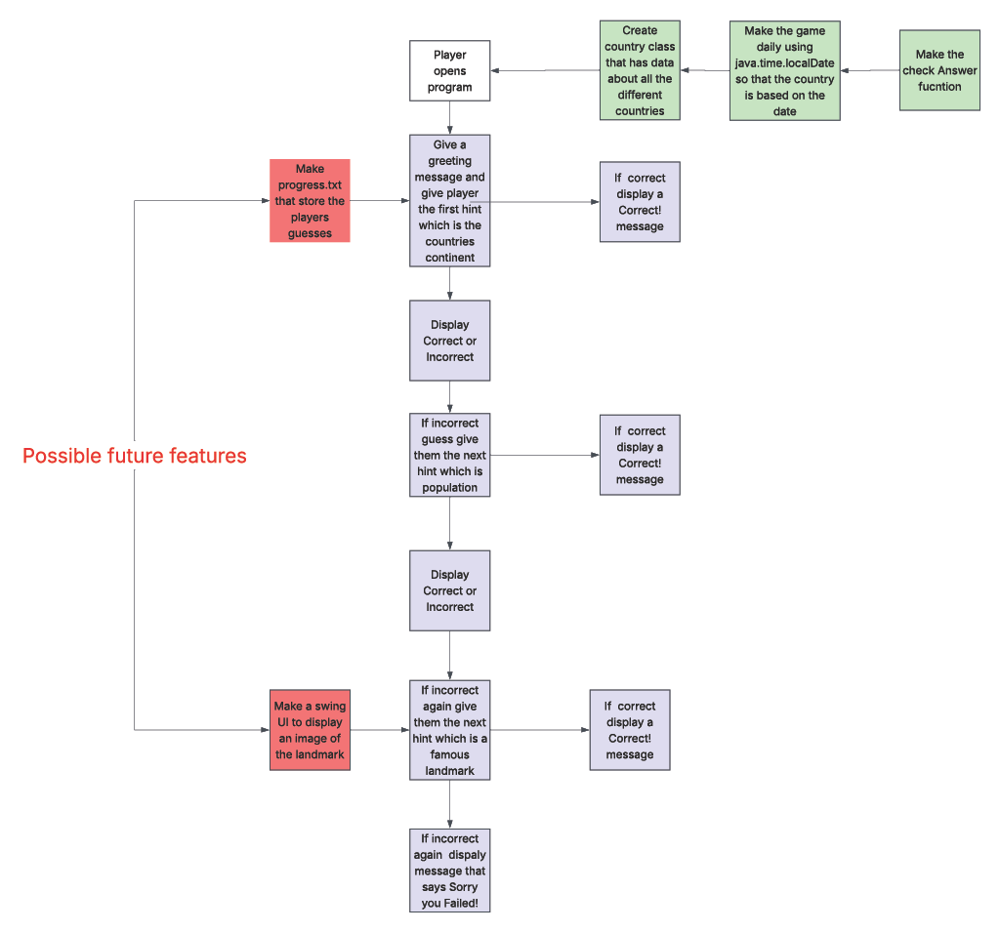

# Country Guesser

A daily console game where you get three hints and try to guess a country

## The Problem

Every day the program picks a country based on the date and gives the player hints. The player tries to guess which country it is. Right now the goal is to have it run in the terminal, with a possible upgrade later, and to make sure it runs completely error free.

## How It Works

Countries.java stores the countries data in parallel arrays. Main.java uses today's date to pick the country and includes the main logic of giving 3 different hints and checking whether a guess is right after each hint. GameWindow.java uses a swing window that displays the hints as text and also includes an image of each country's most famous landmark.

Documents:



[Eisenhower matrix](docs/eisenhower-matrix.pdf)

## Tech Stack

- **Language:** Java version, e.g. 25
- **Libraries:** `java.time.LocalDate` for the daily puzzle, and Swing ('javax.swing', 'java.awt') for the window
- **Tools:** IntelliJ IDEA, Git and GitHub
- **Data storage:** country data is stored in arrays in `Countries.java`, and the landmark photos are '.jpg' files stored in 'resources/images/'.

## Setup and Running

**Requirements:** Java JDK 25. 

1. Clone the repo:
   ```
   git clone https://github.com/jwhalen2098/Country-Guesser.git
   ```
2. Go into the folder:
   ```
   cd Country-Guesser
   ```
3. Compile:
   ```
   javac -d out src/*.java
   ```
4. Run the Swing Window:
   ```
   java -cp out GameWindow
   ```
Run the commands from the repo's root folder because the landmark images are stored in 'resources/images/', otherwise the photos won't show up.

**Example run(this is what the text displays since I can't show the Swing Window in here)** (the country changes each day):

```
Today's puzzle index: 21
Hint 1 (continent): Africa
kenya
Incorrect, next hint
Hint 2 (population): 67,000,000
south africa
Incorrect, next hint
Hint 3 (landmark): Mount Kilimanjaro (with picture)
tanzania
Correct!
```

## MVP Scope

- A system of three hints
- A function that turns the date into a number, so the puzzle is picked by date to make it "daily"
- A check-answer function

## Roadmap

- [x] Set up the GitHub repo and folder structure
- [x] Add the Eisenhower matrix and system diagram
- [x] Build the country data (30 countries)
- [x] Pick the daily puzzle from the date
- [x] Add the three-hint guessing loop and answer checking
- [ ] Add a dropdown or autofill for guesses
- [x] Add a Swing window with images
- [ ] Record the demo video

## Future Plans

- Autofill guesses or a dropdown of countries

## Demo

[Video walkthrough](still working on this)
